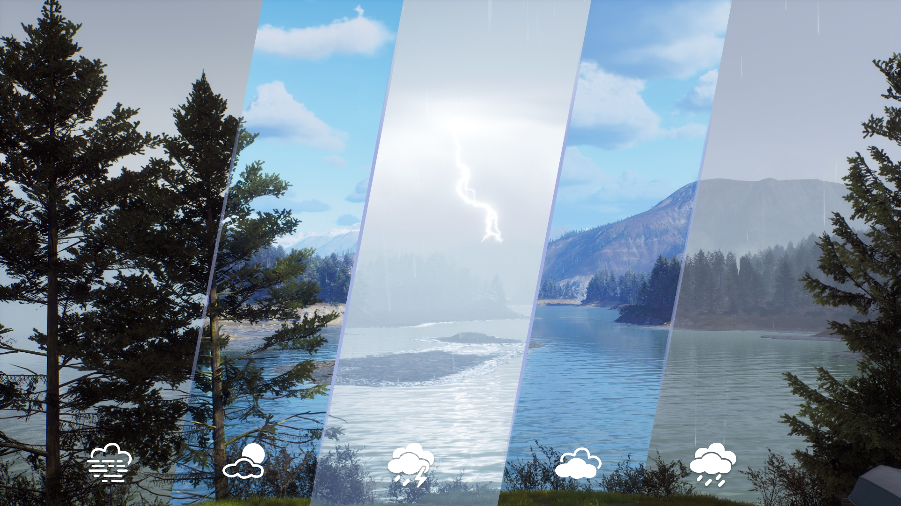
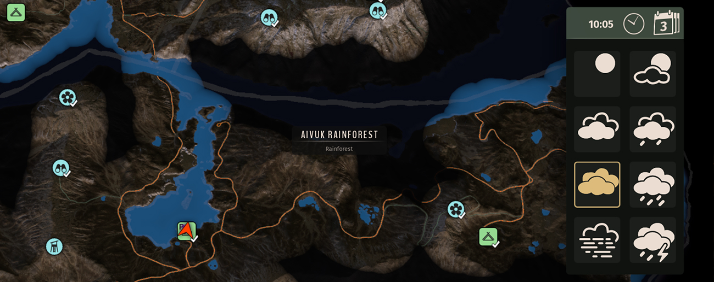
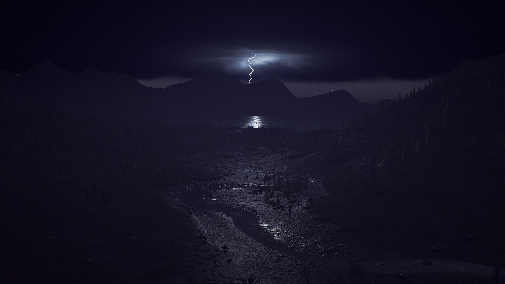

# Weather Control — Way of the Hunter Mod

By Mahpella

Choose from eight weather modes in Way of the Hunter directly on the map, switch conditions immediately, and return to the natural forecast when needed.

## Overview

Sometimes the weather gets in the way of a planned hunt or screenshot, and waiting for the right conditions interrupts what I wanted to do. I wanted a quick way to choose suitable weather without permanently replacing the natural forecast. Weather Control adds a selection panel to the map, applies a temporary weather window and lets me return to the weather that should naturally be active at the current time.

## Download & Install

You can download the mod from my [Website](https://mahpella.com/games/way-of-the-hunter/mods/weather-control) or [Nexus Mods](https://www.nexusmods.com/wayofthehunter/mods/32).

**Installation guide**

### Step 1. Create a backup (optional)

If you wish, copy the Saved folder to another location:  
**Win + R → %LOCALAPPDATA%\WayOfTheHunter**

### Step 2. Open the game folder

Close the game. In Steam, browse the local files for Way of the Hunter and open:  
**WayOfTheHunter\Content\Paks**

### Step 3. Install the mod

Extract the archive and copy all **.pak files into the Paks folder**, replacing older versions if necessary.  
Launch the game and load your save.

## How to Use

- Open the map and press L or click the L prompt to open the weather panel.
- Select one of the eight weather icons; the active mode is highlighted.

- Your selection lasts for the remainder of the current hour and the whole next hour. Selecting another mode starts a new window.
- Click the last mode you selected again to return to the natural weather for the current time.
- Press L again to return to the forecast. Closing the map does not cancel the selected weather window.
- When that window ends, the game resumes its natural weather schedule.

## Feedback

If you find a bug, have suggestions for improving this mod, or have ideas for new mods, I would love to hear from you.

You can also visit [mahpella.com](https://mahpella.com) to explore mods in development and share your ideas for improving your favorite games.

If you would like to support my work → [Buy Me a Coffee](https://buymeacoffee.com/mahpella)

